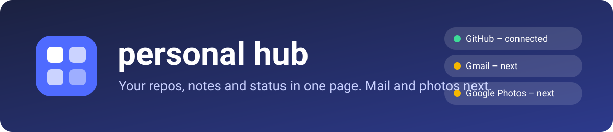
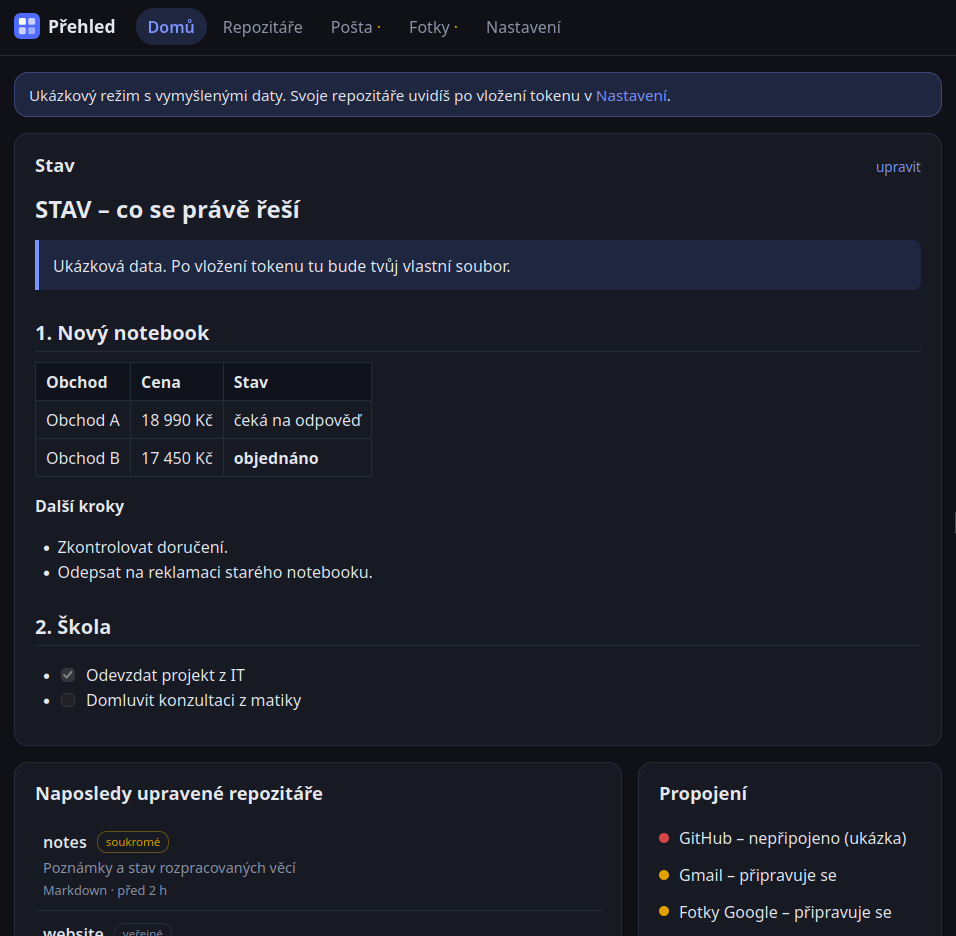
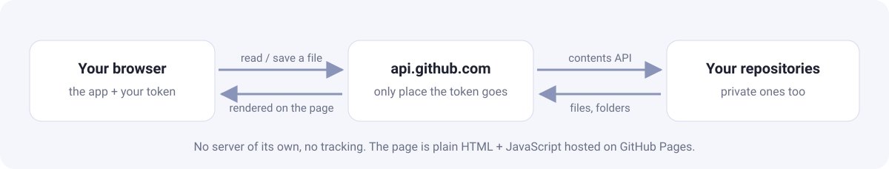

<p align="center"></p>

One page for **your GitHub repos, notes and the status of things you're working on**, on PC and phone.
Free, no install, no server of its own. Plain HTML + JavaScript, no build step. Gmail and Google Photos are coming next.

<p align="center"></p>

> **Your data stays yours.** The app has no backend and no tracking. Your GitHub token is stored only in
> your own browser and is only ever sent to `api.github.com`. Without a token the app runs in a
> **demo mode** with made-up data, so you can try it first. This repository contains only the app,
> nothing personal.

## How it works

<p align="center"></p>

1. **Home.** Shows one Markdown file you pick (for example `STAV.md` in your notes repo) as the
   main status card, plus your most recently updated repos and which services are connected.
2. **Repositories.** All your repos, private ones too, with search. Open any of them to browse folders,
   read files, view images, and see `README.md` rendered like on GitHub (tables, checklists,
   relative links and images work).
3. **Two spaces: Soukromé and Společné.** The tabs at the top split everything into what's only yours
   and what you share. A repo counts as shared when someone else owns it, when you've added collaborators
   (pending invitations included), or when you list it in Settings. **Společné** groups shared repos by person,
   so each friend gets a card with the repos you have together. Give people nicknames in Settings
   (`login = Nickname`). Nicknames stay in your browser.
4. **Quick edits.** Text files have an **Edit** button. Change the file, add a short note, press *Save*,
   and it's committed straight to the repo. If the file changed somewhere else in the meantime,
   nothing is overwritten and you're told to reload first.

## Install

Nothing to install. Open the hosted version:

**https://hauko1.github.io/personal-hub/**

Or run it locally:

```
git clone https://github.com/hauko1/personal-hub
cd personal-hub
python -m http.server 8765        # then open http://localhost:8765
```

## Connect GitHub

1. Open [github.com → Settings → Fine-grained tokens → Generate new token](https://github.com/settings/personal-access-tokens/new).
2. Fill in:

| field | value |
|---|---|
| Token name | `personal hub` |
| Expiration | whatever you like (90 days is a good start) |
| Repository access | **All repositories** (or *Only select repositories*) |
| Permissions → Repository → **Contents** | **Read and write** (*Read-only* works too, then editing is off) |
| Permissions → Repository → **Administration** | *Read-only* (optional: shows invitations nobody has accepted yet in **Společné**) |

3. Copy the token (`github_pat_…`), open **Nastavení** (Settings) in the app and paste it.
4. Optionally set the **main repo** (`owner/name`) and the **status file** (default `STAV.md`) shown on the home page.
5. Press *Uložit a ověřit*. You should see *Připojeno jako …*.

To disconnect, press *Odpojit GitHub* in Settings, or delete the token on GitHub.

## Tips

- Keep one `STAV.md` (status) file with a short table of what's going on. It becomes your home page on every device.
- Use relative links between your notes (`[project](notes/project.md)`). They open inside the app.
- On a phone, use *Add to Home screen* and it behaves like an app.
- Using a shared computer? Disconnect in Settings when you're done.

## Roadmap

- [x] GitHub: repos, files, rendered Markdown, images, editing
- [x] Soukromé / Společné: shared repos grouped by person
- [ ] Gmail: unread mail and replies you're waiting for
- [ ] Google Photos: recent photos
- [ ] Search across everything

## Development

No dependencies to install. Run a local server and open the tests in a browser:

```
python -m http.server 8765
# open http://localhost:8765/tests/
```

The page title turns into `OK <n>` when everything passes. The tests cover:
- **Encoding.** UTF-8 round trips through base64 (Czech characters, emoji, long files) and binary detection.
- **Links inside Markdown.** Relative, `../`, `./`, root-absolute, anchors and encoded names resolve to the right file; external links are left alone.
- **Routing.** Hash routes with unicode paths round-trip correctly.
- **The demo provider.** Same interface as the GitHub client: listing folders, reading text and images, saving, collaborators, and 404s.
- **Spaces.** Splitting repos into personal and shared (collaborators, other owners, pending invitations, repos listed by hand), grouping by person, nicknames and settings parsing.

Markdown is rendered with [marked](https://github.com/markedjs/marked) and sanitised with
[DOMPurify](https://github.com/cure53/DOMPurify), both loaded with pinned versions and integrity hashes.
A strict Content-Security-Policy only allows network requests to `api.github.com`.

## License

MIT
